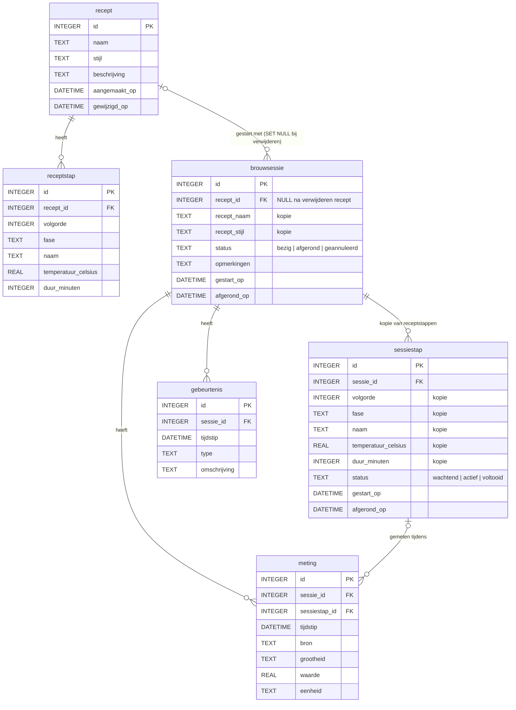
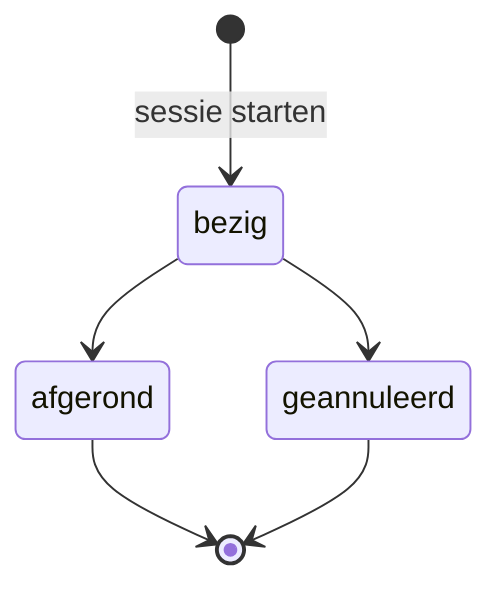

# Architectuur

## Datamodel

### Databasetype

SQLite via de in Node ingebouwde module `node:sqlite` (zie `src/db.ts`). Het schema staat in genummerde migraties in `migrations/`; het datamodel hieronder komt uit `002_recept_en_brouwsessie.sql`.

### Recept en brouwsessie zijn aparte entiteiten

Een **recept** is een sjabloon dat mag veranderen. Een **brouwsessie** is één concrete brouwbeurt. Bij de start van een sessie worden de receptwaarden gekopieerd naar de sessie. Daardoor:

- verandert een sessie niet wanneer het recept achteraf wordt aangepast;
- blijft een sessie volledig raadpleegbaar wanneer het recept wordt verwijderd;
- kan een afgeronde sessie als betrouwbare historiek bewaard worden.

### Tabellen

| Tabel | Inhoud | Relatie |
|---|---|---|
| `recept` | Sjabloon: naam, stijl, beschrijving | — |
| `receptstap` | Stappen van het sjabloon met fase, temperatuur en duur | `recept_id` → `recept`, `ON DELETE CASCADE` |
| `brouwsessie` | Eén brouwbeurt, met kopie van receptnaam en -stijl | `recept_id` → `recept`, `ON DELETE SET NULL`; één recept heeft 0..n sessies |
| `sessiestap` | Kopie van de receptstappen + voortgang van de uitvoering | `sessie_id` → `brouwsessie`, `ON DELETE CASCADE` |
| `meting` | Sensorwaarden en handmatige metingen | `sessie_id` → `brouwsessie`; optioneel `sessiestap_id` → `sessiestap` |
| `gebeurtenis` | Statuswijzigingen, stapovergangen en andere voorvallen | `sessie_id` → `brouwsessie` |

Indexen op `(sessie_id, tijdstip)` voor `meting` en `gebeurtenis` houden grafieken en tijdlijnen per sessie snel.

### Regels

1. **Momentopname bij start.** `POST /api/brouwsessies` maakt in één transactie de sessie aan, kopieert naam en stijl naar `brouwsessie` en alle `receptstap`-rijen naar `sessiestap`.
2. **Uitvoering leest uit de sessie.** De uitvoering van een sessie (stappen doorlopen, metingen koppelen aan de actieve stap) gebruikt alleen `sessiestap`, nooit `receptstap`.
3. **Sessiegegevens horen bij de sessie.** Metingen en gebeurtenissen hebben een `sessie_id`; een statuswijziging wordt ook als gebeurtenis gelogd. Het recept verandert hier nooit door.
4. **Recept verwijderen.** `recept_id` van de sessies wordt `NULL`; naam, stijl en stappen staan als kopie bij de sessie.
5. **Afgeronde sessies zijn vergrendeld.** Een sessie met status `afgerond` of `geannuleerd` kan niet meer gewijzigd worden: niet de sessie zelf, niet haar stappen, metingen of gebeurtenissen. De API antwoordt met `409 Conflict`; triggers in de database weigeren het ook bij rechtstreekse SQL.

### Statusverloop van een brouwsessie

### REST-endpoints voor recept en brouwsessie

| Methode | Pad | Request | Response |
|---|---|---|---|
| `GET` | `/api/recepten` | — | `200` lijst recepten (zonder stappen) |
| `POST` | `/api/recepten` | `{ naam, stijl?, beschrijving?, stappen: [{ fase, naam, temperatuur_celsius?, duur_minuten? }] }` | `201` recept met stappen |
| `GET` | `/api/recepten/:id` | — | `200` recept met stappen, `404` |
| `PUT` | `/api/recepten/:id` | zelfde als `POST` | `200` recept, `404` |
| `DELETE` | `/api/recepten/:id` | — | `204`, `404`; sessies blijven bestaan |
| `GET` | `/api/recepten/:id/brouwsessies` | — | `200` sessies van dit recept |
| `GET` | `/api/brouwsessies` | — | `200` lijst sessies |
| `POST` | `/api/brouwsessies` | `{ recept_id, opmerkingen? }` | `201` sessie met stappen, `404` |
| `GET` | `/api/brouwsessies/:id` | — | `200` sessie met `stappen`, `metingen`, `gebeurtenissen` |
| `PATCH` | `/api/brouwsessies/:id` | `{ status?: 'afgerond' \| 'geannuleerd', opmerkingen? }` | `200`, `409` als afgerond |
| `POST` | `/api/brouwsessies/:id/volgende-stap` | — | `200` sessie, `409` als afgerond of geen stappen meer |
| `POST` | `/api/brouwsessies/:id/metingen` | `{ bron, grootheid, waarde, eenheid, tijdstip?, sessiestap_id? }` | `201` meting, `409` als afgerond |
| `POST` | `/api/brouwsessies/:id/gebeurtenissen` | `{ type, omschrijving? }` | `201` gebeurtenis, `409` als afgerond |

Fouten hebben de vorm `{ "error": "..." }`: `400` ongeldige invoer, `404` niet gevonden, `409` afgeronde sessie.

### Relatie met `001_brouwerij_schema.sql`

Migratie `001` bevat nog de oudere tabellen `recepten`, `brouwsessies`, `brouwsessie_stappen`, `brouwketel_loggegevens` en `vergisting_loggegevens`. De code voor recept en brouwsessie gebruikt de tabellen uit `002`. De ingrediënttabellen uit `001` (`recept_hoppen`, `recept_ingredienten`, ...) verwijzen nog naar `recepten` en moeten bij een volgende migratie naar `recept` verhuizen.
